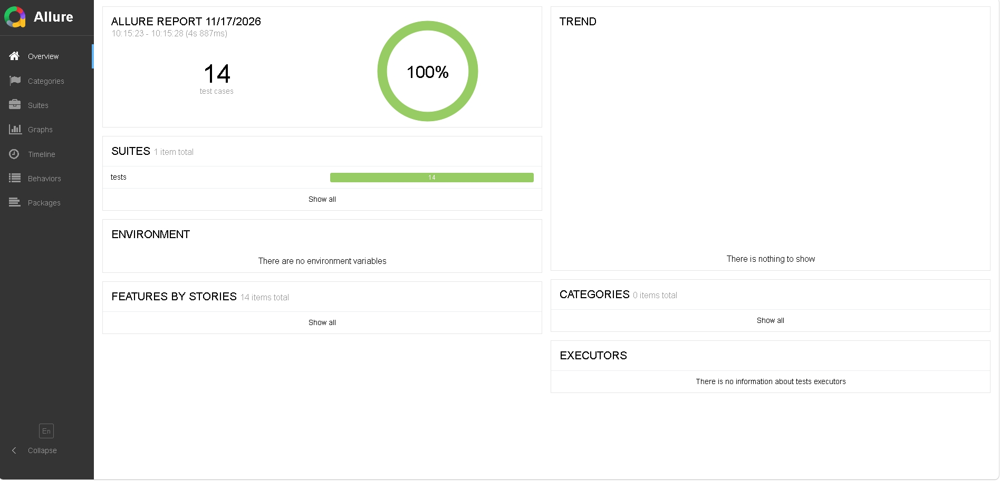

# Restful Booker API Tests

## Что тестирует проект

Тесты проверяют работу API сервиса [Restful Booker](https://restful-booker.herokuapp.com):
- Создание токена авторизации
- Создание бронирования
- Получение списка бронирований и одного бронирования по ID
- Обновление бронирования (PUT и PATCH)
- Удаление бронирования
- Проверка валидации данных

## Установка зависимостей

Для работы проекта нужен Python 3.11 или выше.

Установи все зависимости командой:

```bash
pip install -r requirements.txt
```

## Запуск тестов

Тесты запускаются через `pytest` из корня проекта.

### Окружения

По умолчанию используется окружение `dev`.  
Чтобы запустить тесты на другом окружении, передай флаг `--env`:

```bash
# Dev (по умолчанию)
pytest

# Stage
pytest --env=stage
```

### Allure-отчёт

По умолчанию результаты тестов пишутся в папку `allure-results` (настроено в `pytest.ini`).

Сгенерировать и открыть отчёт:

```bash
allure serve allure-results
```

Сохранить отчёт в папку:

```bash
allure generate allure-results -o allure-report --clean
```



### Flaky-тесты и тайм-ауты

Flaky‑тесты автоматически перезапускаются до 2 раз с задержкой 1 секунда:

- `--reruns=2`
- `--reruns-delay=1`

Каждый тест имеет тайм‑аут 60 секунд:

- `--timeout=60`

Эти опции заданы в `pytest.ini`, в `addopts`. Там же параллельный запуск: `-n auto`.

### Линтинг кода (ruff)

Для проверки качества кода используется linter `ruff`:

```bash
ruff check .
```

Автоматические исправления:

```bash
ruff check . --fix
```
## Запуск в Docker

Запустить Docker Desktop.

docker compose up --build

Файл `.env` не обязателен. Логин и пароль по умолчанию: `admin` / `password123`.
Свои значения можно передать переменными `BOOKER_USERNAME` и `BOOKER_PASSWORD`.

HTML-отчёт собирается сам и лежит в `allure-report/index.html`.
Его можно открыть в браузере.
Сырые результаты остаются в `allure-results`.

## GitHub Actions

Если открыть pull request в main, тесты запустятся сами.
HTML-отчёт Allure будет во вкладке Artifacts, архив называется `allure-report`.